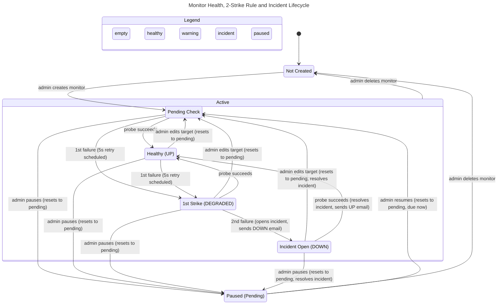
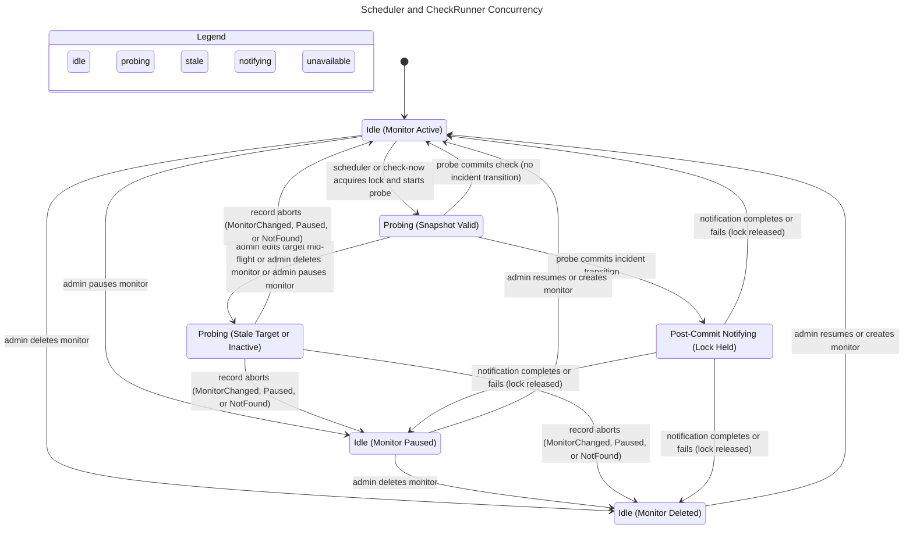
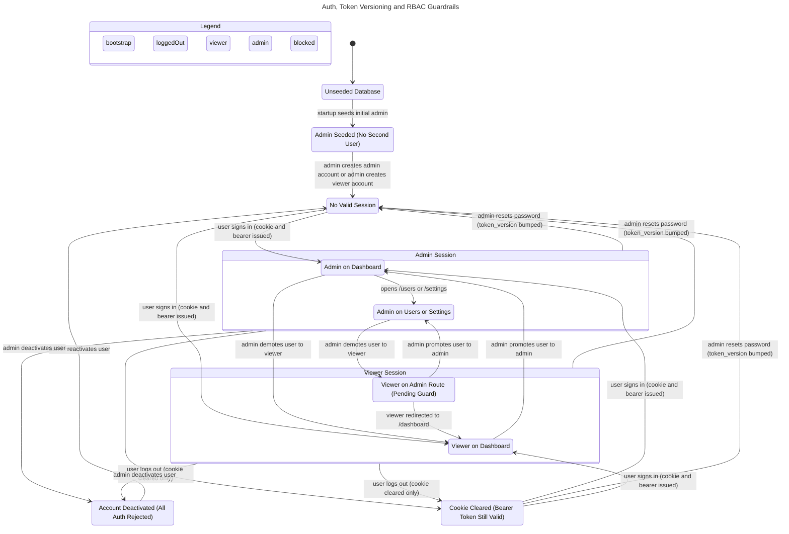
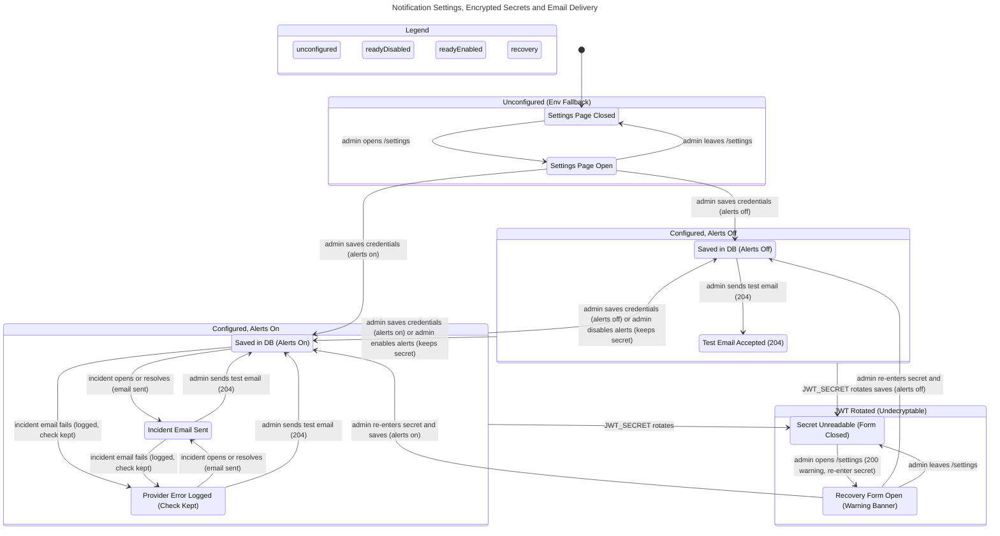

# System and module statecharts

This document records the four TLA+ and TLC statechart verifications against `main` (`1572bf2`).

To regenerate any chart from its spec, view, and config in the scratch folder, run `statechart` with a fresh `--out` directory:

```sh
TLA2TOOLS=.../tools/tla2tools.jar JAVA=/opt/homebrew/opt/openjdk@17/bin/java \
  ~/.gemini/config/plugins/pstack/skills/statechart/scripts/statechart \
  <SPEC.tla> --config <SPEC.cfg> --view <VIEW.ts> --out <OUT_DIR>
```

---

## 1. Monitor health, 2-strike rule, and incident lifecycle

**Source modules:**
- [`backend/app/worker/state.py`](../backend/app/worker/state.py)
- [`backend/app/worker/checker.py`](../backend/app/worker/checker.py)
- [`backend/app/worker/scheduler.py`](../backend/app/worker/scheduler.py)
- [`backend/app/api/v1/monitors.py`](../backend/app/api/v1/monitors.py)
- [`backend/app/api/v1/dashboard.py`](../backend/app/api/v1/dashboard.py)
- [`frontend/src/components/monitors/status-badge.tsx`](../frontend/src/components/monitors/status-badge.tsx)



### Verification summary
- **Model size.** TLC reached 6 states and 24 steps. The chart draws 6 states and 17 arrows, and skips 4 steps that stay in one chart state.
- **Rules that hold.** `TypeOK`, `OpenIncidentOnlyWhenActiveDown`, `ActiveDownHasOpenIncident`, `ActiveDownRequiresTwoFailures`, `DegradedRequiresOneFailure`, `PendingHasNoIncident`, `PausedResetsToPending`, and `NoDeadlock`.
- **Lifecycle behavior.** Pausing, resuming, or editing target fields runs `plan_lifecycle_transition` and `_apply_lifecycle_transition` in `backend/app/api/v1/monitors.py`, which set `current_status` to `PENDING`, reset `consecutive_failures` to `0`, and resolve open incidents.
- **Model scope.** Models a single monitor lifecycle. Leaves out multi-monitor concurrency, time-series `monitor_checks` logging, `ssl_days_remaining` caching, and `HEAD` keyword warnings.

---

## 2. Scheduler and CheckRunner concurrency

**Source modules:**
- [`backend/app/worker/scheduler.py`](../backend/app/worker/scheduler.py)
- [`backend/app/worker/checker.py`](../backend/app/worker/checker.py)
- [`backend/app/worker/prober.py`](../backend/app/worker/prober.py)
- [`backend/app/api/v1/monitors.py`](../backend/app/api/v1/monitors.py)



### Verification summary
- **Model size.** TLC reached 24 states and 82 steps. The chart draws 6 states and 15 arrows, skips 16 self-loop steps, and hides 26 steps in the view.
- **Rules that hold.** `TypeOK`, `IdleHasNoInflight`, `NoStaleWrite`, `NotifyOnlyAfterCommit`, and `NoDeadlock`.
- **Hidden in chart.** `RejectWhenUnavailable`, `RejectConcurrentRun` (`CheckAlreadyRunning`, HTTP `409`), and `AdminEditsTarget` outside `probing`.
- **Model scope.** Models single-process `CheckRunner` admission, `TargetSnapshot` validation, and `WITH FOR UPDATE` commit guards. Leaves out `asyncio.Semaphore(20)` queuing across monitors, dedicated SSL thread-pool timeouts, the 1 MiB response body cap in `prober.py`, and multi-process replica races.

---

## 3. Auth, token versioning, and RBAC guardrails

**Source modules:**
- [`backend/app/db/seed.py`](../backend/app/db/seed.py)
- [`backend/app/api/v1/auth.py`](../backend/app/api/v1/auth.py)
- [`backend/app/api/v1/users.py`](../backend/app/api/v1/users.py)
- [`backend/app/core/deps.py`](../backend/app/core/deps.py)
- [`backend/app/core/security.py`](../backend/app/core/security.py)
- [`frontend/src/lib/auth-context.tsx`](../frontend/src/lib/auth-context.tsx)
- [`frontend/src/lib/server-session.ts`](../frontend/src/lib/server-session.ts)
- [`frontend/src/lib/api.ts`](../frontend/src/lib/api.ts)
- [`frontend/src/app/(app)/users/page.tsx`](../frontend/src/app/(app)/users/page.tsx)
- [`frontend/src/app/(app)/settings/page.tsx`](../frontend/src/app/(app)/settings/page.tsx)



### Verification summary
- **Model size.** TLC reached 47 states and 240 steps. The chart draws 9 states and 20 arrows, skips 124 self-loop steps, and hides 47 steps in the view.
- **Rules that hold.** `TypeOK`, `AlwaysOneActiveAdmin`, `InactiveUserNeverAuthenticates`, `StaleTokensNeverAuthenticate`, and `NoDeadlock`.
- **Hidden in chart.** Bootstrap admin role changes (`AdminDemoteOrDeactivateA` and `AdminRestoreA`), re-login while a valid cookie already exists, deactivating a logged-out user, and reactivating directly into a pre-existing valid token state.
- **Model scope.** Models two users (the seeded admin and a second user), cookie and bearer logout behavior, `token_version` invalidation, the `users_admin_guard` last-admin check, and SSR route guards. Leaves out JWT expiration, legacy tokens without `ver`, bcrypt validation, and `COOKIE_SECURE` startup checks.

---

## 4. Notification settings, encrypted secrets, and email delivery

**Source modules:**
- [`backend/app/notifications/config.py`](../backend/app/notifications/config.py)
- [`backend/app/notifications/settings_store.py`](../backend/app/notifications/settings_store.py)
- [`backend/app/notifications/secrets.py`](../backend/app/notifications/secrets.py)
- [`backend/app/notifications/service.py`](../backend/app/notifications/service.py)
- [`backend/app/notifications/transports.py`](../backend/app/notifications/transports.py)
- [`backend/app/api/v1/notifications.py`](../backend/app/api/v1/notifications.py)
- [`frontend/src/app/(app)/settings/page.tsx`](../frontend/src/app/(app)/settings/page.tsx)
- [`frontend/src/components/settings/notification-settings-view.tsx`](../frontend/src/components/settings/notification-settings-view.tsx)
- [`frontend/src/components/settings/notification-provider-fields.tsx`](../frontend/src/components/settings/notification-provider-fields.tsx)



### Verification summary
- **Model size.** TLC reached 34 states and 184 steps. The chart draws 9 states and 19 arrows, skips 26 self-loop steps, and hides 68 steps in the view.
- **Rules that hold.** `TypeOK`, `NoAlertSentWhenDisabled`, `NoSendWhenUnconfiguredOrUndecryptable`, `SettingsPageLoadsAfterJwtRotation`, `UndecryptableIsNeverConfigured`, and `NoDeadlock`.
- **Recovery behavior.** When `JWT_SECRET` rotates, `GET /api/v1/notifications/settings` calls `load_notification_settings_snapshot` to return non-secret fields with `configured` set to `false` and `unreadable_secrets` populated. The `/settings` page renders a warning banner so an admin can re-enter the secret and save, while `POST /api/v1/notifications/test` (`HTTP 503`) and `DatabaseNotifier` refuse delivery until recovery finishes.
- **Hidden in chart.** `SendTestEmail` when returning `HTTP 502` or `503` without changing state, `WorkerIncidentAlert` when skipped, and no-op saves that keep `enabled` unchanged.
- **Model scope.** Leaves out per-provider field validation (`smtp`, `brevo`, `mailgun`, `mailtrap`), switching providers while another provider's secret is unreadable, and direct `PATCH /api/v1/notifications/settings` requests that omit a replacement secret (`HTTP 422`).
