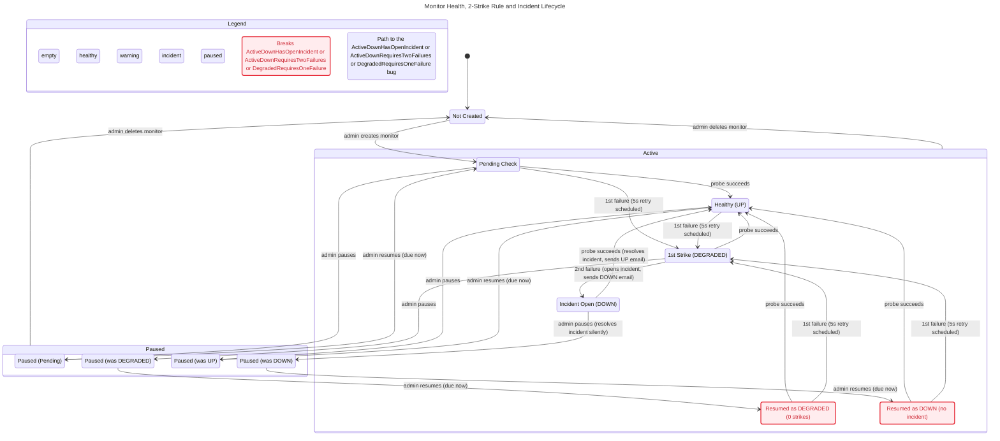
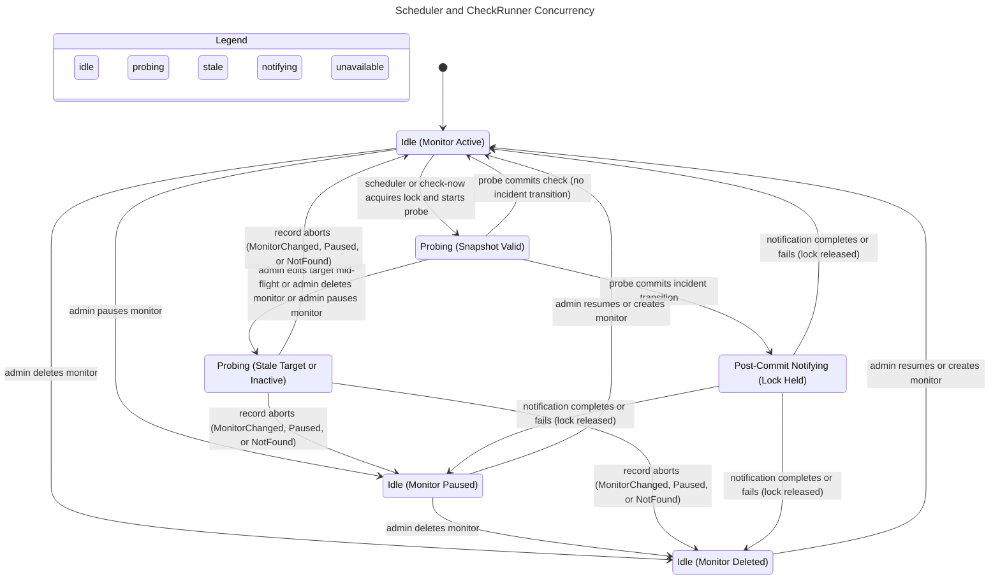
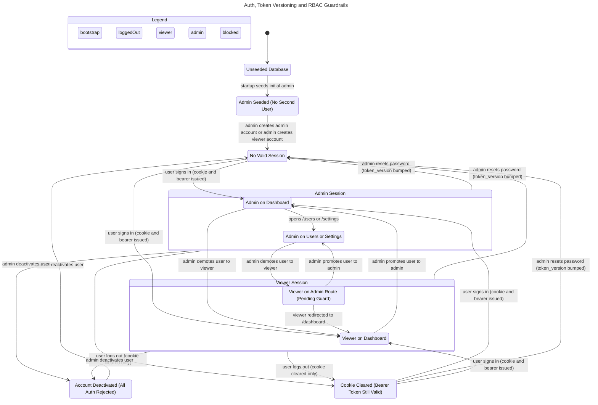
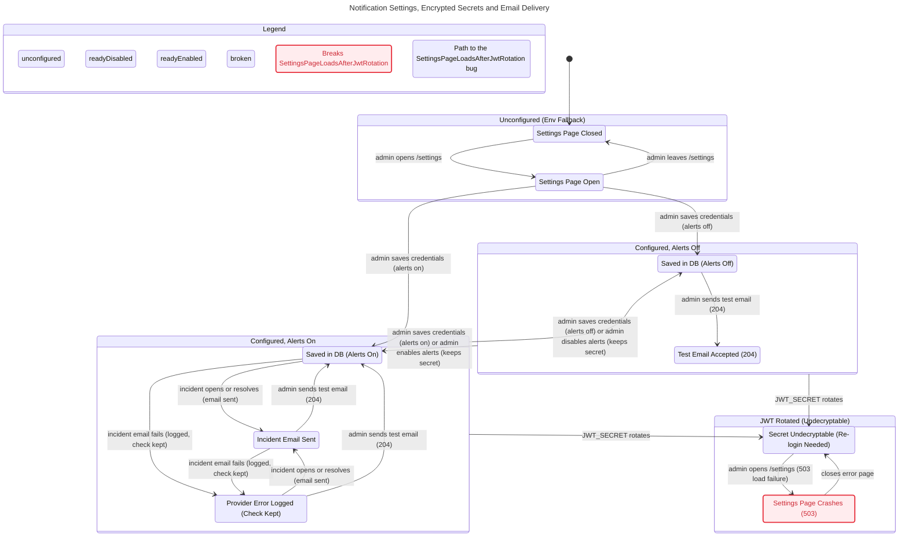

# System & Module Statecharts

This document summarizes the four TLA+ / TLC statecharts and verified findings for the systems and modules in this repository.

---

## 1. Monitor Health, 2-Strike Rule & Incident Lifecycle

**Source modules:**
- [`backend/app/worker/state.py`](../backend/app/worker/state.py)
- [`backend/app/worker/checker.py`](../backend/app/worker/checker.py)
- [`backend/app/worker/scheduler.py`](../backend/app/worker/scheduler.py)
- [`backend/app/api/v1/monitors.py`](../backend/app/api/v1/monitors.py)
- [`backend/app/api/v1/dashboard.py`](../backend/app/api/v1/dashboard.py)
- [`frontend/src/components/monitors/status-badge.tsx`](../frontend/src/components/monitors/status-badge.tsx)

### Verification Summary
- **Model size:** 11 states, 43 steps (chart draws 11 states and 21 arrows).
- **Rules that hold:** `TypeOK`, `OpenIncidentOnlyWhenActiveDown`, `PendingHasNoIncident`, `NoDeadlock`.
- **Broken rules (replayed and confirmed against backend code):**
  - `DegradedRequiresOneFailure` (at `Resumed as DEGRADED (0 strikes)`): `0. Not Created` -> `1. admin creates monitor` -> `2. 1st failure (5s retry scheduled)` -> `3. admin pauses` -> `4. admin resumes (due now)`. Pausing resets `consecutive_failures = 0` without resetting `current_status`, so resuming leaves an active monitor in `DEGRADED` with `0` failures.
  - `ActiveDownHasOpenIncident` & `ActiveDownRequiresTwoFailures` (at `Resumed as DOWN (no incident)`): `0. Not Created` -> `1. admin creates monitor` -> `2. 1st failure (5s retry scheduled)` -> `3. 2nd failure (opens incident, sends DOWN email)` -> `4. admin pauses (resolves incident silently)` -> `5. admin resumes (due now)`. Pausing resolves the open incident and resets `consecutive_failures = 0` without resetting `current_status`, so resuming leaves an active monitor counted as `DOWN` in `/dashboard/summary` and `/monitors?status=down` with `0` failures and no open incident.
- **Hidden in chart:** `EditTarget` resets (which reset any existing monitor to `Pending Check` / `Paused (Pending)` and resolve open incidents) and `PauseMonitor` from `Resumed as DEGRADED` / `Resumed as DOWN`.
- **Model scope:** Models a single monitor lifecycle; leaves out multi-monitor concurrency, time-series `monitor_checks` logging, `ssl_days_remaining` caching, and `HEAD`+keyword warning validation.

---

## 2. Scheduler & CheckRunner Concurrency

**Source modules:**
- [`backend/app/worker/scheduler.py`](../backend/app/worker/scheduler.py)
- [`backend/app/worker/checker.py`](../backend/app/worker/checker.py)
- [`backend/app/worker/prober.py`](../backend/app/worker/prober.py)
- [`backend/app/api/v1/monitors.py`](../backend/app/api/v1/monitors.py)

### Verification Summary
- **Model size:** 24 states, 82 steps (chart draws 6 states and 15 arrows).
- **All rules hold:** `TypeOK`, `IdleHasNoInflight`, `NoStaleWrite`, `NotifyOnlyAfterCommit`, `NoDeadlock`.
- **Hidden in chart:** `RejectWhenUnavailable`, `RejectConcurrentRun` (`CheckAlreadyRunning` 409), and `AdminEditsTarget` outside `probing`.
- **Model scope:** Models single-process `CheckRunner` admission, `TargetSnapshot` validation, and `WITH FOR UPDATE` commit guards; leaves out `asyncio.Semaphore(20)` queuing across multiple monitors, dedicated SSL thread-pool timeouts, `prober.py` 1 MiB body streaming cap, and multi-process replica races.

---

## 3. Auth, Token Versioning & RBAC Guardrails

**Source modules:**
- [`backend/app/db/seed.py`](../backend/app/db/seed.py)
- [`backend/app/api/v1/auth.py`](../backend/app/api/v1/auth.py)
- [`backend/app/api/v1/users.py`](../backend/app/api/v1/users.py)
- [`backend/app/core/deps.py`](../backend/app/core/deps.py)
- [`backend/app/core/security.py`](../backend/app/core/security.py)
- [`frontend/src/lib/auth-context.tsx`](../frontend/src/lib/auth-context.tsx)
- [`frontend/src/lib/server-session.ts`](../frontend/src/lib/server-session.ts)
- [`frontend/src/lib/api.ts`](../frontend/src/lib/api.ts)
- [`frontend/src/app/(app)/users/page.tsx`](../frontend/src/app/(app)/users/page.tsx)
- [`frontend/src/app/(app)/settings/page.tsx`](../frontend/src/app/(app)/settings/page.tsx)

### Verification Summary
- **Model size:** 47 states, 240 steps (chart draws 9 states and 20 arrows).
- **All rules hold:** `TypeOK`, `AlwaysOneActiveAdmin`, `InactiveUserNeverAuthenticates`, `StaleTokensNeverAuthenticate`, `NoDeadlock`.
- **Hidden in chart:** Bootstrap admin role changes (`AdminDemoteOrDeactivateA` / `AdminRestoreA`), re-login while a valid cookie already exists, deactivating an already logged-out user, and reactivating directly into a pre-existing active token state.
- **Model scope:** Models two users (`admin` seed + second user), cookie vs. bearer logout semantics, `token_version` invalidation, the `users_admin_guard` last-admin check, and SSR route guards; leaves out JWT expiration, legacy tokens without `ver`, bcrypt validation, and `COOKIE_SECURE` startup checks.

---

## 4. Notification Settings, Encrypted Secrets & Email Delivery

**Source modules:**
- [`backend/app/notifications/config.py`](../backend/app/notifications/config.py)
- [`backend/app/notifications/settings_store.py`](../backend/app/notifications/settings_store.py)
- [`backend/app/notifications/secrets.py`](../backend/app/notifications/secrets.py)
- [`backend/app/notifications/service.py`](../backend/app/notifications/service.py)
- [`backend/app/notifications/transports.py`](../backend/app/notifications/transports.py)
- [`backend/app/api/v1/notifications.py`](../backend/app/api/v1/notifications.py)
- [`frontend/src/app/(app)/settings/page.tsx`](../frontend/src/app/(app)/settings/page.tsx)
- [`frontend/src/app/(app)/error.tsx`](../frontend/src/app/(app)/error.tsx)

### Verification Summary
- **Model size:** 34 states, 189 steps (chart draws 9 states and 17 arrows).
- **Rules that hold:** `TypeOK`, `NoAlertSentWhenDisabled`, `NoSendWhenUnconfiguredOrUndecryptable`, `NoDeadlock`.
- **Broken rule (replayed and confirmed against backend code):**
  - `SettingsPageLoadsAfterJwtRotation` (at `Settings Page Crashes (503)`): `0. Unconfigured (Env Fallback) / Settings Page Closed` -> `1. admin opens /settings` -> `2. admin saves credentials (alerts off)` -> `3. JWT_SECRET rotates` -> `4. admin opens /settings (503 load failure)`. `GET /api/v1/notifications/settings` attempts to decrypt the active provider's stored secret and raises `HTTP 503`, causing the Next.js `/settings` Server Component to render `error.tsx` instead of the settings form where the admin could re-enter the secret.
- **Hidden in chart:** `SendTestEmail` when returning `502`/`503` without changing state, `WorkerIncidentAlert` when skipped, and no-op saves that keep the same `enabled` value.
- **Model scope:** Leaves out per-provider field validation (`smtp`, `brevo`, `mailgun`, `mailtrap`), switching providers while an unused provider's secret is undecryptable, and direct `PATCH /api/v1/notifications/settings` API calls outside the UI.
